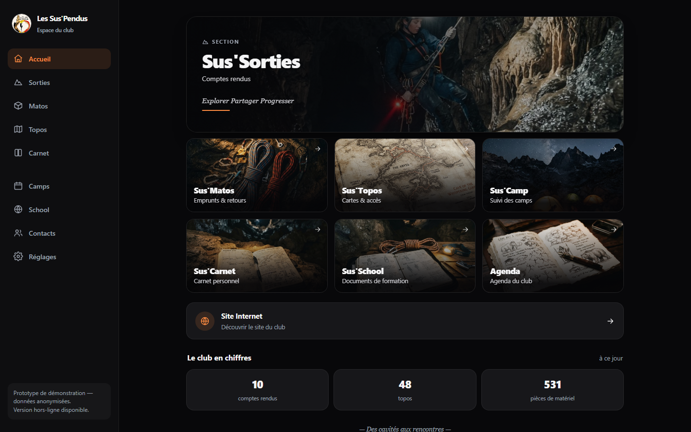
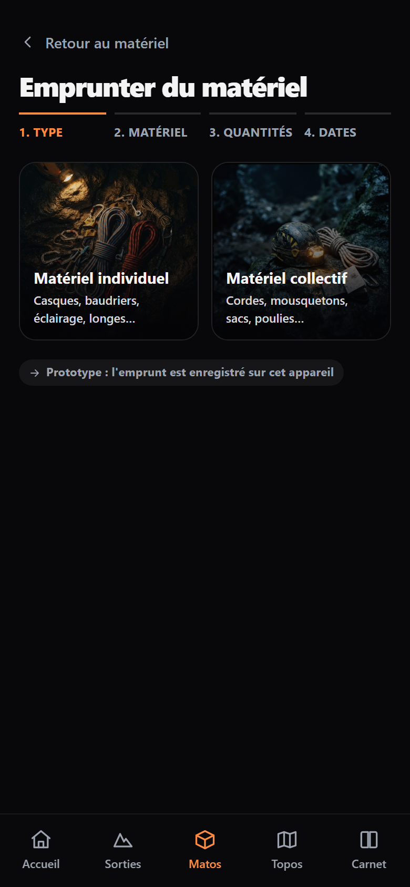

# Les Sus'Pendus — espace du club

Refonte de démonstration de l'espace membres du club de spéléologie **Les Sus'Pendus** :
sorties, matériel, topos, camps, carnet personnel et ressources de formation.

> **Prototype indépendant, non officiel.** Ce dépôt n'est pas l'application du club : c'est une
> maquette fonctionnelle réalisée après un audit de l'app existante, pour montrer à quoi
> ressemblerait une version corrigée. Les données sont réelles mais **anonymisées** (noms des
> membres remplacés, téléphones de secours fictifs, documents non redistribués).



## Ce que ce prototype démontre

| Sujet | App actuelle | Ce prototype |
|---|---|---|
| Contraste (WCAG AA) | 584 éléments en échec | **0** (axe-core, 11 écrans × 2 tailles) |
| Champs de formulaire | 7 champs sans `<label>`, date sans libellé | labels associés, `aria-describedby`, erreurs en `role="alert"` |
| Listes déroulantes | 4 sans nom accessible | toutes nommées |
| Interrupteur « Partager mon numéro » | bouton sans texte | `role="switch"` + `aria-checked` + `aria-labelledby` |
| Langue du document | `lang="en"` sur une app française | `lang="fr"` |
| Navigation clavier | pas d'indicateur de focus | `:focus-visible` sur tous les contrôles |
| Poids de l'app | 1,4 Mo de JS + 2,5 Mo au login | **105 Ko gzip**, 18 Ko de CSS |
| Hors-ligne | aucun service worker | PWA installable, coquille + données en cache |
| Emprunt de matériel | quantités seules, pas de dates | stock visible, compteur, **dates de retour**, rappel |
| Matériel | liste plate de 41 lignes | regroupé par catégorie, recherche, fiche, **étiquette QR** |
| Topos | doublons par cavité | regroupés par cavité, filtres, « télécharger hors-ligne » |
| Mobile | barre d'onglets | identique, avec zones tactiles ≥ 44 px |
| Desktop | colonne étroite centrée | barre latérale + grille 3 colonnes |

## Écrans

- **Accueil** — accès aux sections, chiffres du club
- **Sus'Sorties** — comptes rendus, recherche, fiche avec participants
- **Sus'Matos** — parc de matériel, emprunt en 4 étapes, retours, rapports, étiquettes QR
- **Sus'Topos** — bibliothèque des cavités, filtres par discipline, hors-ligne
- **Sus'Carnet** — carnet personnel, ajout d'une sortie
- **Sus'Camps** — camp et programme jour par jour
- **Sus'School** — documents de formation par thème
- **Sus'Contacts** — secours et annuaire (fictif ici)
- **Réglages** — profil, partage du numéro, informations sur l'app

<p align="center">
  
</p>

## Démarrage

```bash
npm install
npm run dev      # http://localhost:5173
npm run build    # dist/
npm run preview  # sert le build
```

Aucun backend, aucune variable d'environnement : les données sont des fichiers JSON embarqués,
les emprunts et le carnet sont stockés dans le `localStorage` du navigateur.

## Structure

```
src/
  data/          données extraites de l'app du club puis anonymisées
  pages/         un fichier par écran
  components/    Layout (barre latérale + onglets), UI (feuille modale, puces, champs)
  lib/store.js   persistance locale (emprunts, carnet)
  styles.css     système de design (tokens, contrastes validés AA)
public/
  images/        visuels du club
  sw.js          service worker (hors-ligne)
```

## Accessibilité

Vérifié avec **axe-core** (WCAG 2.1 A/AA + bonnes pratiques) sur les 11 écrans, en 1440×900 et
390×844 : **0 violation**, 0 erreur JavaScript.

Les contrastes sont documentés dans `src/styles.css` : chaque couleur de texte a été choisie pour
dépasser 4,5:1 sur son fond (par exemple `#1a1206` sur l'orange `#ff8c42` = 8,0:1, là où le blanc
tombait à 2,3:1).

## Déploiement

Pousser sur `main` déclenche `.github/workflows/deploy.yml` : build Vite puis publication sur
GitHub Pages (une fois Pages activé sur le dépôt, source « GitHub Actions »).

## Limites assumées

- Pas d'authentification : c'est une démonstration, pas un espace sécurisé.
- Pas de synchronisation entre appareils (tout est local).
- Les documents PDF du club ne sont pas inclus ; les liens sont représentatifs.
- Le contenu éditorial (textes de sorties, fiches) reste à compléter par le club.
